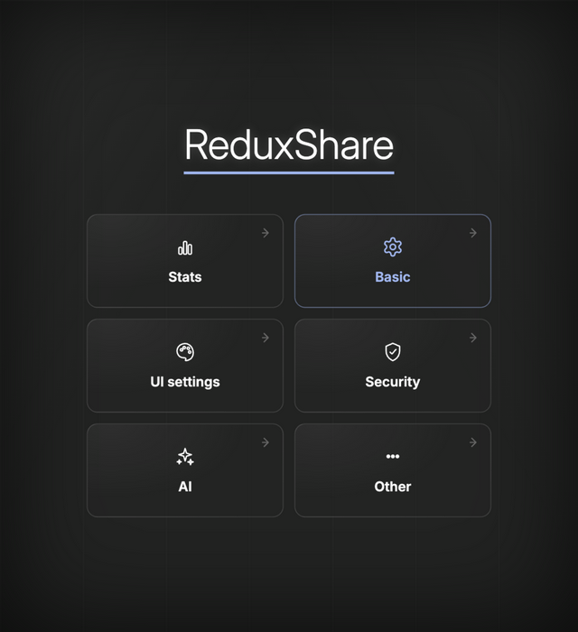
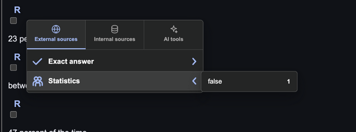
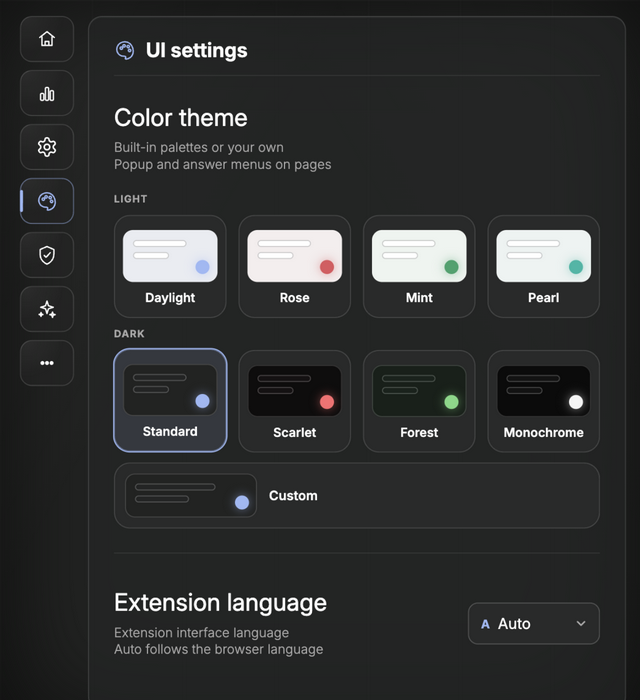

<p align="center">
  
</p>
<h1 align="center">ReduxShare</h1>

<p align="center">
  Browser extension for Moodle quizzes with shared answer statistics, review imports, full interface themes, and AI-assisted solving.
</p>
<p align="center">
  <a href="https://github.com/krchvl/ReduxShare/releases/latest">
    
  </a>
  
  
  
</p>
<p align="center">
  
</p>
<p align="center">
  <strong>🇺🇸 English</strong>
  ·
  <a href="README.ru.md">🇷🇺 Русский</a>
</p>

<p align="center">
  <a href="#about">About</a>
  ·
  <a href="#preview">Preview</a>
  ·
  <a href="#features">Features</a>
  ·
  <a href="#installation">Installation</a>
  ·
  <a href="#quick-start">Quick start</a>
  ·
  <a href="#how-it-works">How it works</a>
  ·
  <a href="#configuration">Configuration</a>
  ·
  <a href="#development">Development</a>
  ·
  <a href="#privacy">Privacy</a>
  ·
  <a href="#license">License</a>
</p>

---

## About

**ReduxShare** is a Moodle-focused browser extension for quiz solving and answer analysis. It mounts contextual `R` widgets on quiz attempt pages, aggregates shared answer statistics collected from the community, imports verified answers from Moodle review pages, and can fill controls automatically — with optional AI assistance from nine providers or a self-hosted official AI gateway.

Built with **TypeScript**, **React**, **Vite**, and **PocketBase** (self-hosted) or **Firebase** as the storage backend.

ReduxShare is not affiliated with Moodle, Google, or any Moodle instance.

## Preview

<p align="center">
  
  
</p>
<p align="center">
  
</p>

The popup is organized as a section menu that collapses into an icon rail, and the whole interface — popup and on-page widgets alike — follows one of the interface themes.

## Features

### Shared answer intelligence

- **Inline answer widgets** — compact `R` widgets appear next to every supported question control on `attempt.php`.
- **Shared answer statistics** — aggregated answers collected from previous attempts of other users, with per-option counts and 👍/👎 voting for unverified answers.
- **Review import** — parsed right answers, selected answers, and drag/drop metadata from `review.php` are normalized and stored, deduplicating repeated imports.
- **Correctness-aware matching** — verified answers, unknown selections, and plain statistics are kept separate; only verified answers are auto-applied, and answers with a 👎 majority are excluded.
- **Essay answer examples** — save your essay as a shared example from the R-menu and vote for the best ones; a 👎-majority example sinks to the bottom.

### AI assistance

- **9 providers** — Google Gemini, OpenAI, Anthropic, Groq, Mistral, xAI, DeepSeek, OpenRouter, or any custom OpenAI-compatible endpoint with your own key.
- **Official AI mode** — on PocketBase builds, requests go through a self-hosted gateway with per-plan rate limits; available models are listed per subscription plan (free/low/medium/high) and configured server-side without rebuilding the extension.
- **Answer explanations** — ask the configured provider to explain the correct answer in the interface language.
- AI tools are disabled for question types where text-only context is not reliable (`ddmarker`, `ddimageortext`).

### Automation

- **Auto-apply** — verified exact answers can fill Moodle controls automatically with type-aware application logic for choices, text inputs, matching, Cloze, ordering, and drag/drop.
- **Auto-pass** — a floating page button starts a session that walks through the whole quiz, scheduling answers with humanized pacing.
- **Humanization** — configurable tempo presets, reading-time pauses, character-by-character typing, scroll/focus precursors, and randomized answer order; manual input always cancels pending automation.
- **Countdown** — a progress bar with remaining seconds under the active widget while an answer is being scheduled.

### Interface

- **Interface themes** — eight full-gamma presets (four dark: Standard, Scarlet, Forest, Monochrome; four light: Daylight, Rose, Mint, Pearl) plus a fully customizable theme with per-color editing. Themes restyle the popup **and** the on-page widgets.
- **Section menu** — the popup opens as a section grid that collapses into an icon rail; the logo hides while a section is open to free space.
- **Personal stats** — solved tests, accuracy, imported questions, contributor leaderboard, and attempt history.
- **Guest access** — browse the popup without signing in; sign-in gated sections are blurred until authorized.
- **Hotkey** — the `R` trigger hotkey is configurable in settings.
- **i18n** — English and Russian, picked by browser language or manually.

### Manifest V3 ready

Minimal permissions (`storage`, `activeTab`, `alarms`), content scripts scoped to Moodle quiz pages only, all AI keys stored in local extension storage, and a classic bundled content script (no remote code).

### Moodle question type coverage

| Task Type                    | DOM name           | Support | Internal Sources | External Sources | AI Tools |
| :--------------------------- | :----------------- | :-----: | :--------------: | :--------------: | :------: |
| Calculated                   | `calculated`       |   ✅    |        ✅        |        🔴        |    ✅    |
| Calculated multi-choice      | `calculatedmulti`  |   ✅    |        ✅        |        🔴        |    ✅    |
| Calculated simple            | `calculatedsimple` |   ✅    |        ✅        |        🔴        |    ✅    |
| Drag and drop into text      | `ddwtos`           |   ✅    |        ✅        |        🔴        |    ✅    |
| Drag and drop markers        | `ddmarker`         |   🟡    |        ✅        |        🔴        |    🔴    |
| Drag and drop onto image     | `ddimageortext`    |   🟡    |        ✅        |        🔴        |    🔴    |
| Essay                        | `essay`            |   🟡    |        🟡        |        🔴        |    ✅    |
| Matching                     | `match`            |   ✅    |        ✅        |        ✅        |    ✅    |
| Embedded answers / Cloze     | `multianswer`      |   ✅    |        ✅        |        ✅        |    ✅    |
| Multiple choice              | `multichoice`      |   ✅    |        ✅        |        ✅        |    ✅    |
| Ordering                     | `ordering`         |   ✅    |        ✅        |        🔴        |    ✅    |
| Short answer                 | `shortanswer`      |   ✅    |        ✅        |        ✅        |    ✅    |
| Numerical                    | `numerical`        |   ✅    |        ✅        |        ✅        |    ✅    |
| Random short-answer matching | `randomsamatch`    |   ✅    |        ✅        |        ✅        |    ✅    |
| Select missing words         | `gapselect`        |   ✅    |        ✅        |        ✅        |    ✅    |
| True/False                   | `truefalse`        |   ✅    |        ✅        |        ✅        |    ✅    |

🟡 in the **Internal Sources** column for `essay` means the shared answer **examples with voting** are available; exact answers and per-option statistics do not apply to essay questions.

## Installation

### From releases

Download `reduxshare-chrome-vX.Y.Z.zip` (Chromium) or `reduxshare-firefox-vX.Y.Z.xpi` (Firefox) from the [latest release](https://github.com/krchvl/ReduxShare/releases/latest):

- **Chromium** (Chrome, Edge, Brave): unzip, open `chrome://extensions`, enable **Developer mode**, click **Load unpacked**, select the unzipped directory.
- **Firefox**: open `about:addons` → gear icon → **Install Add-on From File…** and pick the `.xpi`.

### From source

Requirements:

- Node.js 20 or newer
- npm
- A self-hosted PocketBase URL or a Firebase project for the internal answer sources (configured in `.env`)

```bash
git clone https://github.com/krchvl/ReduxShare.git
cd ReduxShare
npm install
cp .env.example .env
```

Set the backend provider in `.env`. PocketBase is the default:

```bash
VITE_DATA_PROVIDER=pocketbase
VITE_POCKETBASE_URL=https://pb.example.com
```

Or switch to Firebase:

```bash
VITE_DATA_PROVIDER=firebase
VITE_FIREBASE_API_KEY=AIzaSy...
VITE_FIREBASE_PROJECT_ID=reduxshare-xxxxx
```

The provider is selected at build time, so rebuild after changing it. Do not commit `.env` — only `.env.example` is stored in Git.

```bash
npm run build        # chrome → dist/chrome
npm run build:all    # chrome + firefox
```

Load it in the browser:

1. Open `chrome://extensions` or the equivalent extensions page.
2. Enable **Developer mode**.
3. Click **Load unpacked**.
4. Select the generated `dist/chrome` directory.
5. Pin ReduxShare from the browser toolbar if needed.

## Quick start

1. Load the extension (see [Installation](#installation)).

2. Open the popup and sign in on your PocketBase/Firebase backend — or press **Continue without sign-in** to browse as a guest.

3. Open a Moodle quiz attempt page:

```text
https://your-moodle.example/mod/quiz/attempt.php?...
```

4. Wait for `R` widgets to appear near supported question controls (or press the configured hotkey).

5. Click an `R` widget:

   - **Internal sources** — saved answers and shared statistics;
   - **External sources** — results from the external-compatible provider;
   - **AI tools** — after configuring an AI provider in the AI section.

6. To contribute verified answers, submit the quiz and open the Moodle review page — ReduxShare parses and saves the review data automatically:

```text
https://your-moodle.example/mod/quiz/review.php?...
```

## How it works

ReduxShare runs as a Manifest V3 browser extension on Moodle quiz pages.

1. **Attempt page detection** — on `attempt.php` the content script scans visible questions, detects Moodle question types, builds stable question hashes, and mounts `R` widgets near the answer controls.

2. **Answer lookup** — two sources are queried for matching variants: internal sources (the shared database) and external sources (the external-compatible provider).

3. **R-menu** — clicking `R` opens a shadow-DOM menu with Internal / External / AI tabs; essays show community examples with voting instead of per-option statistics.

4. **Correctness handling** — verified review answers are saved as exact answers and may be auto-applied; hidden-review or uncertain answers are saved as statistics only.

5. **Review import** — on `review.php` the extension parses right-answer blocks, selected answers, per-slot controls, and drag/drop metadata, then sends the normalized payload to the background worker for storage.

6. **Auto-apply & auto-pass** — exact answers fill Moodle controls with type-aware logic; an optional auto-pass session walks through the whole quiz with humanized pacing.

7. **Update checks** — the background worker compares the GitHub raw `.VERSION` file with the installed version; the popup shows a dismissible update pill (manual check in the "Other" section), and quiz pages can show a dismissible notice.

## Configuration

### Backend provider

`VITE_DATA_PROVIDER` selects the storage backend at build time: `pocketbase` (default) or `firebase`. Authentication, answer storage, review imports, votes, essay examples, profiles, the leaderboard, and attempt history all follow this switch.

### PocketBase (self-hosted)

ReduxShare uses a self-hosted PocketBase instance for authentication and sessions, profile state, quiz progress, and internal answer storage:

```bash
VITE_POCKETBASE_URL=https://pb.example.com
```

Collection definitions live in `pocketbase/pb_migrations/` and are created automatically on the first server start after copying them next to the PocketBase binary. Serve PocketBase behind a reverse proxy with TLS (e.g. Caddy) and create a superuser with `pocketbase superuser upsert`.

On PocketBase builds you can additionally deploy the official AI gateway (`pocketbase/pb_hooks/main.pb.js` + [gpt-load](https://github.com/tbphp/gpt-load)) to share AI access across users with per-plan limits; see the hooks file for the deployment notes.

### Firebase

Create a Firebase project, enable the Email/Password sign-in provider, and create a Cloud Firestore database in **Standard edition** (previously called Native mode). Put the Web API key and project ID into `.env` and rebuild. The complete step-by-step guide, including rules deployment, security notes, quotas, backups, and troubleshooting, is in [`firebase/README.md`](firebase/README.md).

Deploy the Firestore security rules from this repository:

```bash
npx firebase-tools deploy --config firebase/firebase.json --only firestore:rules --project reduxshare-xxxxx
```

Data model:

- `users/{uid}` — public profile and counters; `usernames/{hash}` — case-insensitive username reservation.
- `tasks/{hash}` — aggregated answer rows keyed by the question/answer identity.
- `taskVotes/{taskId}__{uid}` — per-user answer votes.
- `reviewImports/{uid}__{hash}` — review import deduplication and attempt history.
- `essayExamples/{uid}__{hash}` and `essayVotes/{exampleId}__{uid}` — essay examples and votes.

There is no automatic migration from PocketBase to Firebase; a Firebase build starts with an empty database.

### AI

- **Custom provider mode** — pick any of the nine providers (or a custom OpenAI-compatible endpoint) in the popup AI section and paste your API key. Keys are stored in browser extension storage and are used only for requests initiated by ReduxShare.
- **Official AI mode** — PocketBase builds can route AI requests through the self-hosted gateway: plans define per-user minute/day limits and the model pool; the model list is delivered by the server, so plans are adjusted without rebuilding the extension. Firebase builds expose only the custom provider mode.

### Updates

Keep these versions aligned before release:

- `.VERSION`
- `package.json` `version`
- `public/manifest.json` `version`

The extension checks the GitHub raw `.VERSION` file and links users to the latest GitHub release when an update is available.

## Development

### Scripts

| Command              | What it does                                             |
| :------------------- | :------------------------------------------------------- |
| `npm run dev`        | Popup UI at `/` and the widget playground at `/dev.html` |
| `npm run build`      | Production build → `dist/chrome`                         |
| `npm run build:all`  | Chrome + Firefox builds                                  |
| `npm run typecheck`  | `tsc -b --noEmit` — must pass before commit              |
| `npm run lint`       | ESLint (`lint:fix` to autofix)                           |
| `npm test`           | Vitest suite — DOM parsing, menus, auto-apply, AI, votes |
| `npm run test:watch` | Vitest watch mode                                        |
| `npm run test:db`    | Live PocketBase save checks (needs test credentials)     |

### Widget playground

`npm run dev` serves a widget playground at `/dev.html`: Moodle question fixtures with mocked browser APIs and in-memory answer data, so the R-menu, statistics flyouts, and the preview panel can be exercised without building the extension or touching a real Moodle page.

### Live backend tests

For live PocketBase save checks (needs `VITE_POCKETBASE_URL` in `.env`), provide test credentials in the environment and run:

```bash
POCKETBASE_TEST_EMAIL=you@example.com
POCKETBASE_TEST_PASSWORD=your-password
npm run test:db
```

### Content-script invariant

After every production build, verify that the Moodle content script remains a classic bundled script without top-level imports:

```bash
rg -n "^(import|export)\b" dist/chrome/assets/quizAttempt.js
```

The command should return no matches.

## Contributing

Issues and pull requests are welcome. Keep commits conventional (`feat(popup): …`), add tests for behavior changes, and run `npm run typecheck && npm run lint && npm test` before submitting.

## Privacy

ReduxShare is designed to work with Moodle quiz pages and may process quiz-related data required for its features.

Depending on the enabled features, the extension may handle:

- Moodle domain
- Course and quiz identifiers
- Question identifiers
- Question type metadata
- Answer variants
- Quiz review data
- Shared answer statistics
- Extension settings
- Authentication state

ReduxShare does not need access to unrelated browsing history to provide its core functionality. The manifest only targets Moodle quiz attempt, summary, and review URLs for content scripts.

Depending on enabled features and configuration, ReduxShare may contact:

- your configured PocketBase instance;
- the external answer provider;
- GitHub raw content for update checks;
- the selected AI provider (Google Gemini, another supported provider, your custom endpoint, or the official AI gateway) when AI tools are enabled.

AI suggestions are optional. When enabled, the question content and relevant answer options may be sent to the selected AI provider in order to generate a response.

**<u>Do not enable AI suggestions if you do not want quiz content to be processed by an external AI provider.</u>**

API keys for AI providers are stored in the browser extension storage and are used only for requests initiated by the extension.

## License

This project is licensed under the **GNU General Public License v3.0**.

The GPL-3.0 license permits use, study, modification, and distribution of the source code under its terms.

See the [LICENSE](LICENSE) file for the full license text.
