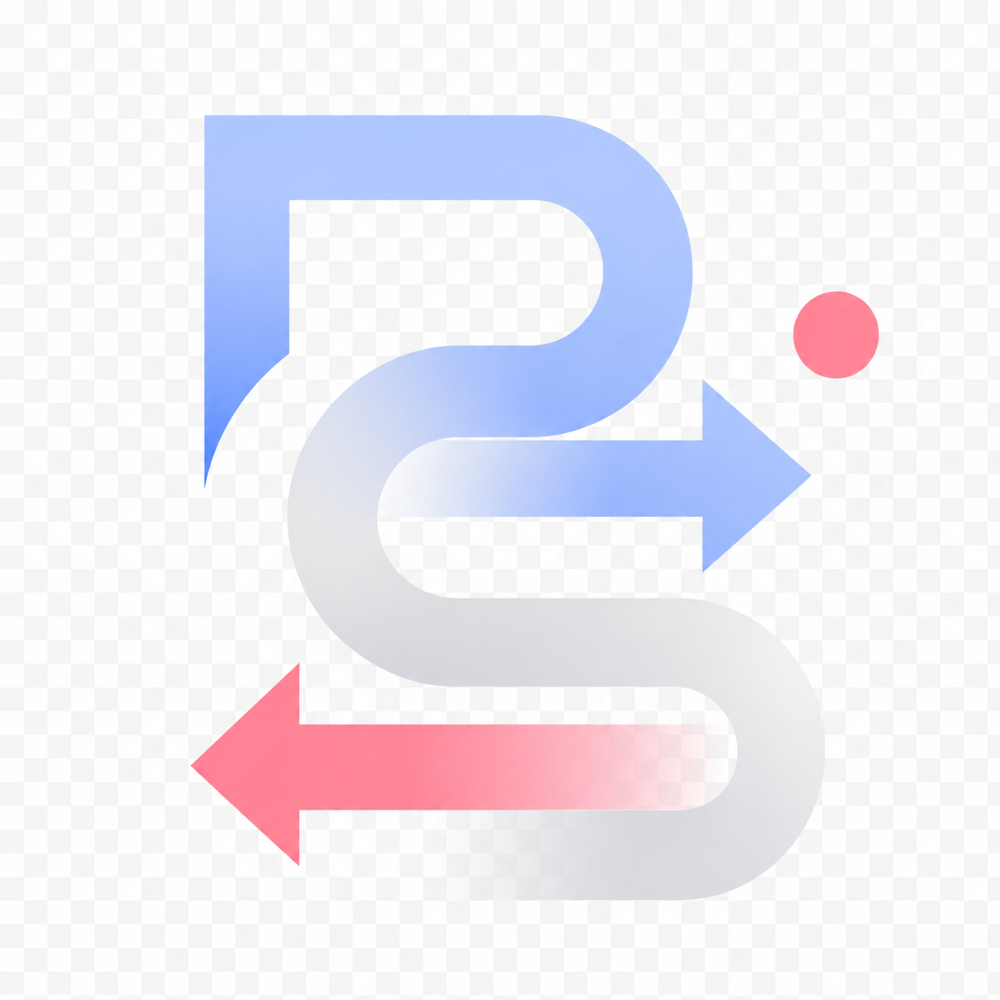
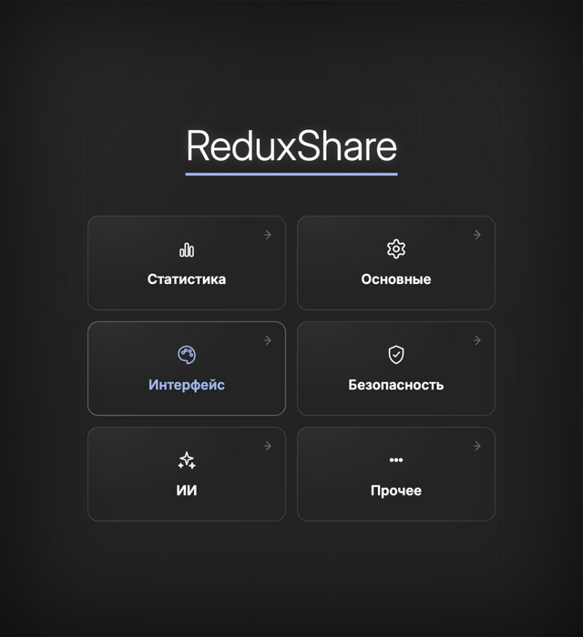
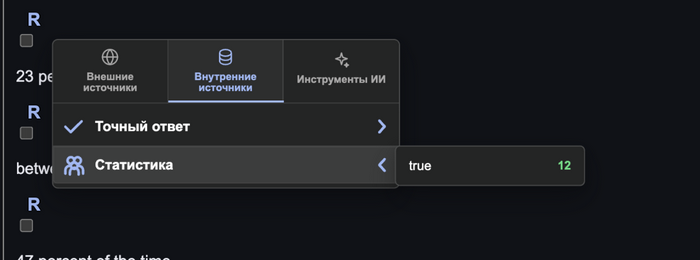
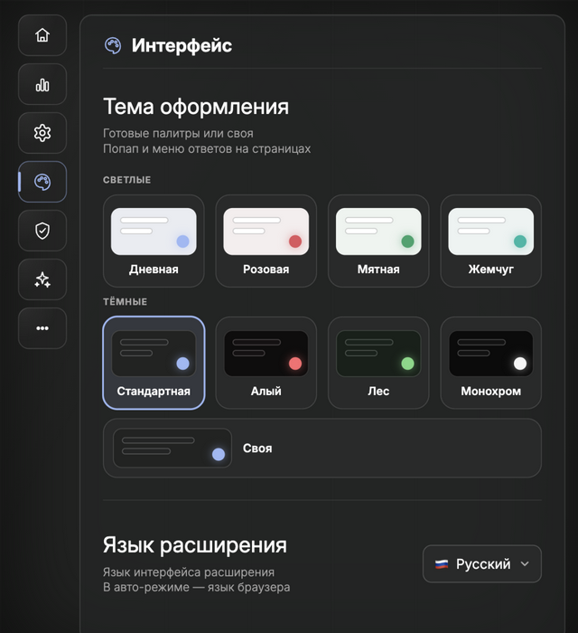

<p align="center">
  
</p>
<h1 align="center">ReduxShare</h1>

<p align="center">
  Браузерное расширение для тестов Moodle с общей статистикой ответов, импортом обзоров, полноценными темами интерфейса и решением с помощью ИИ.
</p>
<p align="center">
  <a href="https://github.com/krchvl/ReduxShare/releases/latest">
    
  </a>
  
  
  
</p>

<p align="center">
  
</p>
<p align="center">
  <a href="README.md">🇺🇸 English</a>
  ·
  <strong>🇷🇺 Русский</strong>
</p>

<p align="center">
  <a href="#о-проекте">О проекте</a>
  ·
  <a href="#превью">Превью</a>
  ·
  <a href="#возможности">Возможности</a>
  ·
  <a href="#установка">Установка</a>
  ·
  <a href="#быстрый-старт">Быстрый старт</a>
  ·
  <a href="#как-это-работает">Как это работает</a>
  ·
  <a href="#настройка">Настройка</a>
  ·
  <a href="#разработка">Разработка</a>
  ·
  <a href="#приватность">Приватность</a>
  ·
  <a href="#лицензия">Лицензия</a>
</p>

---

## О проекте

**ReduxShare** — браузерное расширение для решения и анализа тестов Moodle. Оно монтирует контекстные виджеты `R` на страницах прохождения тестов, собирает общую статистику ответов сообщества, импортирует проверенные ответы со страниц обзора Moodle и может заполнять контролы автоматически — с опциональной помощью ИИ от девяти провайдеров или самохостингового официального AI-шлюза.

Построено на **TypeScript**, **React**, **Vite** и **PocketBase** (самохостинг) либо **Firebase** в качестве хранилища.

ReduxShare не связан с Moodle, Google или какими-либо инстансами Moodle.

## Превью

<p align="center">
  
  
</p>
<p align="center">
  
</p>

Попап устроен как меню секций, которое сворачивается в иконочный рейл, а весь интерфейс — попап и виджеты на страницах — следует одной из тем оформления.

## Возможности

### Общая база ответов

- **Виджеты ответов на странице** — компактные виджеты `R` появляются рядом с каждым поддерживаемым контролом вопроса на `attempt.php`.
- **Общая статистика ответов** — агрегированные ответы из предыдущих попыток других пользователей, счётчики по вариантам и голосование 👍/👎 за непроверенные ответы.
- **Импорт обзоров** — правильные ответы, выбранные варианты и метаданные drag/drop со страницы `review.php` нормализуются и сохраняются с дедупликацией повторных импортов.
- **Разделение по корректности** — проверенные ответы, неизвестные выборы и простая статистика хранятся отдельно; автоматически применяются только проверенные ответы, а варианты с большинством 👎 исключаются.
- **Примеры эссе** — сохраните своё эссе как общий пример из R-меню и голосуйте за лучшие; пример с большинством 👎 опускается вниз списка.

### Помощь ИИ

- **9 провайдеров** — Google Gemini, OpenAI, Anthropic, Groq, Mistral, xAI, DeepSeek, OpenRouter или любой кастомный эндпоинт, совместимый с OpenAI, со своим ключом.
- **Официальный AI-режим** — на сборках PocketBase запросы идут через самохостинговый шлюз с лимитами по тарифным планам; список моделей отдаётся сервером для каждого плана (free/low/medium/high) и настраивается без пересборки расширения.
- **Объяснение ответа** — попросите настроенного провайдера объяснить правильный ответ на языке интерфейса.
- ИИ отключён для типов вопросов, где текстовый контекст ненадёжен (`ddmarker`, `ddimageortext`).

### Автоматизация

- **Авто-применение** — проверенные точные ответы могут заполнять контролы Moodle автоматически с типо-ориентированной логикой для выбора, текстовых полей, сопоставления, Cloze, упорядочивания и drag/drop.
- **Автопрогон** — плавающая кнопка на странице запускает сессию, которая проходит весь тест, планируя ответы с очеловеченным темпом.
- **Гуманизация** — пресеты темпа, паузы на чтение, посимвольный ввод, скролл/фокус перед ответом и случайный порядок ответов; ручной ввод всегда отменяет запланированную автоматизацию.
- **Обратный отсчёт** — прогресс-бар с оставшимися секундами под активным виджетом, пока ответ планируется.

### Интерфейс

- **Темы оформления** — восемь полноохватных пресетов (четыре тёмных: Стандартная, Алый, Лес, Монохром; четыре светлых: Дневная, Розовая, Мятная, Жемчуг) плюс полностью настраиваемая тема с редактированием каждого цвета. Темы перекрашивают попап **и** виджеты на страницах.
- **Меню секций** — попап открывается сеткой секций, которая сворачивается в иконочный рейл; логотип скрывается, пока открыта секция, освобождая место под настройки.
- **Личная статистика** — решённые тесты, точность, импортированные вопросы, лидерборд контрибьюторов и история попыток.
- **Гостевой доступ** — используйте попап без входа; закрытые секции блюрятся до авторизации.
- **Горячая клавиша** — хотклавиша виджета `R` настраивается в настройках.
- **i18n** — русский и английский, выбирается по языку браузера или вручную.

### Manifest V3

Минимальные разрешения (`storage`, `activeTab`, `alarms`), контент-скрипты только на страницах тестов Moodle, все ключи ИИ — в локальном хранилище расширения, классический бандл контент-скрипта (без удалённого кода).

### Покрытие типов вопросов Moodle

| Тип вопроса                  | DOM name           | Поддержка | Внутренние источники | Внешние источники | ИИ  |
| :--------------------------- | :----------------- | :-------: | :------------------: | :---------------: | :-: |
| Calculated                   | `calculated`       |    ✅     |          ✅          |        🔴         | ✅  |
| Calculated multi-choice      | `calculatedmulti`  |    ✅     |          ✅          |        🔴         | ✅  |
| Calculated simple            | `calculatedsimple` |    ✅     |          ✅          |        🔴         | ✅  |
| Drag and drop into text      | `ddwtos`           |    ✅     |          ✅          |        🔴         | ✅  |
| Drag and drop markers        | `ddmarker`         |    🟡     |          ✅          |        🔴         | 🔴  |
| Drag and drop onto image     | `ddimageortext`    |    🟡     |          ✅          |        🔴         | 🔴  |
| Essay                        | `essay`            |    🟡     |          🟡          |        🔴         | ✅  |
| Matching                     | `match`            |    ✅     |          ✅          |        ✅         | ✅  |
| Embedded answers / Cloze     | `multianswer`      |    ✅     |          ✅          |        ✅         | ✅  |
| Multiple choice              | `multichoice`      |    ✅     |          ✅          |        ✅         | ✅  |
| Ordering                     | `ordering`         |    ✅     |          ✅          |        🔴         | ✅  |
| Short answer                 | `shortanswer`      |    ✅     |          ✅          |        ✅         | ✅  |
| Numerical                    | `numerical`        |    ✅     |          ✅          |        ✅         | ✅  |
| Random short-answer matching | `randomsamatch`    |    ✅     |          ✅          |        ✅         | ✅  |
| Select missing words         | `gapselect`        |    ✅     |          ✅          |        ✅         | ✅  |
| True/False                   | `truefalse`        |    ✅     |          ✅          |        ✅         | ✅  |

🟡 в колонке **Внутренние источники** для `essay` означает доступность общих **примеров с голосованием**; точные ответы и статистика по вариантам к эссе неприменимы.

## Установка

### Из релизов

Скачайте `reduxshare-chrome-vX.Y.Z.zip` (Chromium) или `reduxshare-firefox-vX.Y.Z.xpi` (Firefox) из [последнего релиза](https://github.com/krchvl/ReduxShare/releases/latest):

- **Chromium** (Chrome, Edge, Brave): распакуйте архив, откройте `chrome://extensions`, включите **Режим разработчика**, нажмите **Загрузить распакованное расширение** и выберите распакованную папку.
- **Firefox**: откройте `about:addons` → шестерёнка → **Установить дополнение из файла…** и выберите `.xpi`.

### Из исходников

Требования:

- Node.js 20 или новее
- npm
- URL самохостингового PocketBase или Firebase-проект для внутренних источников ответов (настраивается в `.env`)

```bash
git clone https://github.com/krchvl/ReduxShare.git
cd ReduxShare
npm install
cp .env.example .env
```

Укажите бэкенд-провайдера в `.env`. PocketBase — по умолчанию:

```bash
VITE_DATA_PROVIDER=pocketbase
VITE_POCKETBASE_URL=https://pb.example.com
```

Или переключитесь на Firebase:

```bash
VITE_DATA_PROVIDER=firebase
VITE_FIREBASE_API_KEY=AIzaSy...
VITE_FIREBASE_PROJECT_ID=reduxshare-xxxxx
```

Провайдер выбирается на этапе сборки — после смены пересоберите. Не коммитьте `.env` — в Git хранится только `.env.example`.

```bash
npm run build        # chrome → dist/chrome
npm run build:all    # chrome + firefox
```

Загрузка в браузер:

1. Откройте `chrome://extensions` или аналогичную страницу расширений.
2. Включите **Режим разработчика**.
3. Нажмите **Загрузить распакованное расширение**.
4. Выберите собранную папку `dist/chrome`.
5. При необходимости закрепите ReduxShare на панели браузера.

## Быстрый старт

1. Загрузите расширение (см. [Установка](#установка)).

2. Откройте попап и войдите на вашем PocketBase/Firebase-бэкенде — или нажмите **Продолжить без входа**, чтобы пользоваться как гость.

3. Откройте страницу прохождения теста в Moodle:

```text
https://your-moodle.example/mod/quiz/attempt.php?...
```

4. Дождитесь виджетов `R` рядом с поддерживаемыми контролами вопросов (или нажмите настроенную горячую клавишу).

5. Кликните виджет `R`:

   - **Внутренние источники** — сохранённые ответы и общая статистика;
   - **Внешние источники** — результаты внешне-совместимого провайдера;
   - **Инструменты ИИ** — после настройки провайдера в секции ИИ.

6. Чтобы поделиться проверенными ответами, сдайте тест и откройте страницу обзора Moodle — ReduxShare распарсит и сохранит данные обзора автоматически:

```text
https://your-moodle.example/mod/quiz/review.php?...
```

## Как это работает

ReduxShare работает как браузерное расширение Manifest V3 на страницах тестов Moodle.

1. **Определение страницы прохождения** — на `attempt.php` контент-скрипт сканирует видимые вопросы, определяет типы вопросов Moodle, строит стабильные хэши вопросов и монтирует виджеты `R` рядом с контролами ответов.

2. **Поиск ответов** — запрос идёт к двум источникам: внутренние источники (общая база) и внешние источники (внешне-совместимый провайдер).

3. **R-меню** — клик по `R` открывает shadow-DOM меню с вкладками Внутренние / Внешние / ИИ; для эссе показываются общие примеры с голосованием вместо статистики по вариантам.

4. **Работа с корректностью** — проверенные ответы обзора сохраняются как точные и могут применяться автоматически; скрытые или неопределённые ответы сохраняются только как статистика.

5. **Импорт обзора** — на `review.php` расширение разбирает блоки правильных ответов, выбранные варианты, поконтрольные элементы и метаданные drag/drop, затем отправляет нормализованный payload в фоновый воркер на хранение.

6. **Авто-применение и автопрогон** — точные ответы заполняют контролы Moodle типо-ориентированной логикой; опциональная сессия автопрогона проходит весь тест с очеловеченным темпом.

7. **Проверка обновлений** — фоновый воркер сравнивает raw-файл `.VERSION` на GitHub с установленной версией; попап показывает открываемую плашку обновления (ручная проверка в секции «Прочее»), а на страницах тестов может появляться открываемое уведомление.

## Настройка

### Бэкенд-провайдер

`VITE_DATA_PROVIDER` выбирает хранилище на этапе сборки: `pocketbase` (по умолчанию) или `firebase`. Аутентификация, хранение ответов, импорт обзоров, голоса, примеры эссе, профили, лидерборд и история попыток следуют этому переключателю.

### PocketBase (самохостинг)

ReduxShare использует самохостинговый инстанс PocketBase для аутентификации и сессий, состояния профиля, прогресса тестов и внутреннего хранилища ответов:

```bash
VITE_POCKETBASE_URL=https://pb.example.com
```

Определения коллекций лежат в `pocketbase/pb_migrations/` и создаются автоматически при первом запуске сервера после копирования их рядом с бинарником PocketBase. Размещайте PocketBase за обратным прокси с TLS (например, Caddy) и создайте суперюзера командой `pocketbase superuser upsert`.

На сборках PocketBase дополнительно можно развернуть официальный AI-шлюз (`pocketbase/pb_hooks/main.pb.js` + [gpt-load](https://github.com/tbphp/gpt-load)) для общего доступа к ИИ с лимитами по планам; заметки по развёртыванию — в файле хуков.

### Firebase

Создайте Firebase-проект, включите провайдер входа Email/Password и создайте базу Cloud Firestore в редакции **Standard** (раньше — Native mode). Положите Web API key и project ID в `.env` и пересоберите. Полный пошаговый гайд, включая деплой правил, заметки по безопасности, квоты, бэкапы и troubleshooting, — в [`firebase/README.md`](firebase/README.md).

Задеплойте правила безопасности Firestore из репозитория:

```bash
npx firebase-tools deploy --config firebase/firebase.json --only firestore:rules --project reduxshare-xxxxx
```

Модель данных:

- `users/{uid}` — публичный профиль и счётчики; `usernames/{hash}` — резервирование имени без учёта регистра.
- `tasks/{hash}` — агрегированные строки ответов по идентичности вопроса/ответа.
- `taskVotes/{taskId}__{uid}` — голоса пользователя за ответы.
- `reviewImports/{uid}__{hash}` — дедупликация импорта обзоров и история попыток.
- `essayExamples/{uid}__{hash}` и `essayVotes/{exampleId}__{uid}` — примеры эссе и голоса.

Автоматической миграции с PocketBase на Firebase нет; Firebase-сборка стартует с пустой базой.

### ИИ

- **Кастомный режим** — выберите любого из девяти провайдеров (или кастомный OpenAI-совместимый эндпоинт) в секции ИИ попапа и вставьте свой API-ключ. Ключи хранятся в локальном хранилище расширения и используются только для запросов, инициированных ReduxShare.
- **Официальный AI-режим** — сборки PocketBase могут направлять запросы ИИ через самохостинговый шлюз: планы задают лимиты на пользователя в минуту/день и пул моделей; список моделей отдаётся сервером, поэтому планы настраиваются без пересборки расширения. В Firebase-сборках доступен только кастомный режим.

### Обновления

Перед релизом держите версии синхронными:

- `.VERSION`
- `package.json` `version`
- `public/manifest.json` `version`

Расширение сверяет raw-файл `.VERSION` на GitHub с установленной версией и ведёт пользователя на последний GitHub-релиз, когда доступно обновление.

## Разработка

### Скрипты

| Команда              | Что делает                                                    |
| :------------------- | :------------------------------------------------------------ |
| `npm run dev`        | Попап UI на `/` и плейграунд виджетов на `/dev.html`          |
| `npm run build`      | Прод-сборка → `dist/chrome`                                   |
| `npm run build:all`  | Сборки Chrome + Firefox                                       |
| `npm run typecheck`  | `tsc -b --noEmit` — должен проходить перед коммитом           |
| `npm run lint`       | ESLint (`lint:fix` — автопричёсывание)                        |
| `npm test`           | Сьют Vitest — парсинг DOM, меню, авто-применение, ИИ, голоса  |
| `npm run test:watch` | Vitest в watch-режиме                                         |
| `npm run test:db`    | Живые проверки сохранения в PocketBase (нужны тестовые креды) |

### Плейграунд виджетов

`npm run dev` поднимает плейграунд виджетов на `/dev.html`: фикстуры вопросов Moodle с замоканными браузерными API и ответами в памяти — R-меню, флайауты статистики и панель предпросмотра можно гонять без сборки расширения и реальной страницы Moodle.

### Живые тесты бэкенда

Для живых проверок сохранения в PocketBase (нужен `VITE_POCKETBASE_URL` в `.env`) укажите тестовые креды в окружении и запустите:

```bash
POCKETBASE_TEST_EMAIL=you@example.com
POCKETBASE_TEST_PASSWORD=your-password
npm run test:db
```

### Инвариант контент-скрипта

После каждой прод-сборки проверяйте, что контент-скрипт Moodle остаётся классическим бандлом без top-level импортов:

```bash
rg -n "^(import|export)\b" dist/chrome/assets/quizAttempt.js
```

Команда не должна возвращать совпадений.

## Участие

Issue'и и pull request'ы приветствуются. Держите коммиты конвенциональными (`feat(popup): …`), добавляйте тесты к изменениям поведения и прогоняйте `npm run typecheck && npm run lint && npm test` перед сабмитом.

## Приватность

ReduxShare спроектирован для работы со страницами тестов Moodle и может обрабатывать относящиеся к тестам данные, необходимые для его функций.

В зависимости от включённых функций расширение может обрабатывать:

- домен Moodle
- идентификаторы курса и теста
- идентификаторы вопросов
- метаданные типов вопросов
- варианты ответов
- данные обзоров тестов
- общую статистику ответов
- настройки расширения
- состояние аутентификации

ReduxShare не требуется доступ к посторонней истории браузера для основной функциональности. Манифест таргетит контент-скриптами только URL попыток, summary и обзоров тестов Moodle.

В зависимости от включённых функций и конфигурации ReduxShare может обращаться к:

- вашему настроенному инстансу PocketBase;
- внешнему провайдеру ответов;
- raw-контенту GitHub для проверки обновлений;
- выбранному провайдеру ИИ (Google Gemini, другой поддерживаемый провайдер, ваш кастомный эндпоинт или официальный AI-шлюз), если инструменты ИИ включены.

Подсказки ИИ опциональны. При включении содержимое вопроса и относящиеся варианты ответов могут отправляться выбранному провайдеру ИИ для генерации ответа.

**<u>Не включайте подсказки ИИ, если не хотите, чтобы содержимое теста обрабатывалось внешним провайдером ИИ.</u>**

API-ключи провайдеров ИИ хранятся в локальном хранилище браузерного расширения и используются только для запросов, инициированных расширением.

## Лицензия

Проект лицензирован под **GNU General Public License v3.0**.

Лицензия GPL-3.0 разрешает использование, изучение, изменение и распространение исходного кода на её условиях.

Полный текст лицензии — в файле [LICENSE](LICENSE).
